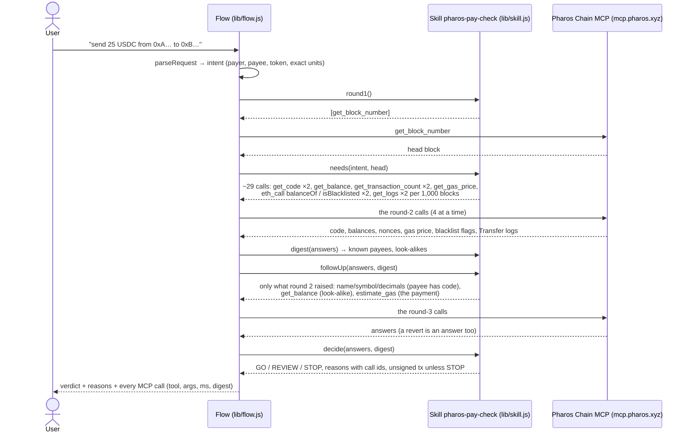

# The flow: what calls what, and in what order

## Round by round

| round | asked by | Chain MCP tools | why |
|---|---|---|---|
| 1 | `round1()` | `get_block_number` | the head block — which blocks the history covers |
| 2 | `needs()` | `get_code` (payer, payee) | wallet or contract? |
| | | `get_balance` (payer) | PROS for gas (and the amount for a PROS payment) |
| | | `get_transaction_count` (payer, payee) | the payer's nonce for the transaction; has the payee ever transacted? |
| | | `get_gas_price` | the fee |
| | | `eth_call` `balanceOf(payer)` | the token balance |
| | | `eth_call` `isBlacklisted(payer / payee)` | USDC only |
| | | `get_logs` Transfer(from = payer) / Transfer(to = payer), per 1,000 blocks | who the payer pays, who pays the payer (the MCP serves 1,000 blocks per call) |
| — | `digest()` | none | known payees, typical amounts, look-alikes (same first 4 and last 4 hex characters) |
| 3 | `followUp()` | `eth_call` `name()/symbol()/decimals()` | only if the payee has code: is it a token? |
| | | `get_balance` (requested payee) | only for a look-alike: its own footprint |
| | | `estimate_gas` (the payment) | would it go through? A revert's reason is evidence |
| — | `decide()` | none | the verdict; every reason lists the ids of the calls above |

Each call is recorded with its id (`c1`, `c2`, …), round, tool, arguments, the reason it was made, its duration and
a keccak digest of the MCP's answer (or its error).
